# AWS Security Monitoring & Active Defense — "SoloGaurd"

> Detect access to a sensitive secret, alert the security team two different ways, and automatically quarantine the identity that touched it — then prove every step with forensic evidence.

| | |
|---|---|
| **Author** | Sunday Ogunleye (Student ID ALT_SOE_BAR_026_0071) |
| **Project** | Cloud Security Semester Project — Final Forensic Report |
| **Region** | Africa (Cape Town) — `af-south-1` |
| **Test date** | 7–8 September 2026 |
| **Services** | CloudTrail · CloudWatch Logs / Metrics / Alarms · SNS · EventBridge · Systems Manager Automation · IAM · Secrets Manager · S3 |
| **Status** | ✅ Detection (2 paths) · ✅ Notification · ✅ Automated containment · ✅ Forensic verification |

---

## Contents

1. [Executive summary](#1-executive-summary)
2. [Threat model & objectives](#2-threat-model--objectives)
3. [Architecture](#3-architecture)
4. [Component reference](#4-component-reference)
5. [How each path works](#5-how-each-path-works)
6. [Evidence](#6-evidence)
7. [Forensic correlation & timeline](#7-forensic-correlation--timeline)
8. [Security analysis (assignment questions)](#8-security-analysis-assignment-questions)
9. [Lessons learned](#9-lessons-learned)
10. [Limitations & production hardening](#10-limitations--production-hardening)
11. [Reproduce the lab](#11-reproduce-the-lab)
12. [Repository layout](#12-repository-layout)
13. [Submission evidence checklist](#13-submission-evidence-checklist)

Further reading in [`docs/`](docs): a step-by-step [build guide](docs/build-guide.md), the full [forensic timeline](docs/forensic-timeline.md), [troubleshooting](docs/troubleshooting.md), [production hardening](docs/production-hardening.md) and the [review notes](docs/review-notes.md) listing what changed from the original submitted PDF.

---

## 1. Executive summary

The goal was to build an AWS pipeline that can **detect** access to a sensitive AWS Secrets Manager secret, **notify** the security team, and **respond automatically** by containing the identity that accessed it.

I planted a honeytoken secret, `Production_Database_Credentials`, that no legitimate workload uses — so any read of it is suspicious by definition. Every API call against it is captured by a multi-Region CloudTrail trail and evaluated by two independent detection paths:

- **Flow 1 — metric-based:** CloudTrail → CloudWatch Logs → metric filter (`GetSecretValue` on the honeytoken) → 1-minute alarm (≥ 1) → SNS email.
- **Flow 2 — event-based:** CloudTrail → EventBridge rule matching the exact API call → SNS email.

For active defense, a controlled IAM user called **`Victim`** read the secret. An EventBridge rule matched that successful read and started a Systems Manager Automation runbook, which attached the deny-all permissions boundary **`SoloGaurd-QuarantineBoundary`** to the user. The Victim's next `GetSecretValue` call failed with **`AccessDeniedException`** ("explicit deny in a permissions boundary"), and CloudTrail recorded the matching `errorCode: AccessDenied` event at **2026-09-08T09:35:15Z**.

I also built and ran an earlier **kill-switch** variant that disabled the Victim's access key instead. Comparing the two produced the key forensic finding of the project: *disabling a key causes an authentication-layer failure, while a deny-all boundary lets the request reach authorization and leaves a clean, attributable `AccessDenied` record.*

The result is a complete learning-scale loop: **audit → detect → notify → contain → verify.**

---

## 2. Threat model & objectives

| Item | Description |
|---|---|
| **Asset** | `Production_Database_Credentials` in Secrets Manager — a decoy (honeytoken) holding fake credentials. |
| **Threat** | A compromised or malicious IAM principal enumerating and reading secrets (MITRE ATT&CK **T1555.006 — Credentials from Password Stores: Cloud Secrets Management Stores**). |
| **Signal** | Any `secretsmanager:GetSecretValue` call whose `secretId` is the honeytoken. Because nothing legitimate reads it, a single call is a high-fidelity alert — no baseline or tuning needed. |
| **Test identity** | IAM user `Victim` with an identity policy allowing only `GetSecretValue`/`DescribeSecret` on the honeytoken, used from AWS CloudShell with CLI profile `sologuard-victim`. |
| **Objectives** | (1) Record the access. (2) Alert through two independent paths. (3) Contain the identity automatically without human action. (4) Prove containment from both the client side (CLI) and the server side (CloudTrail). |

---

## 3. Architecture

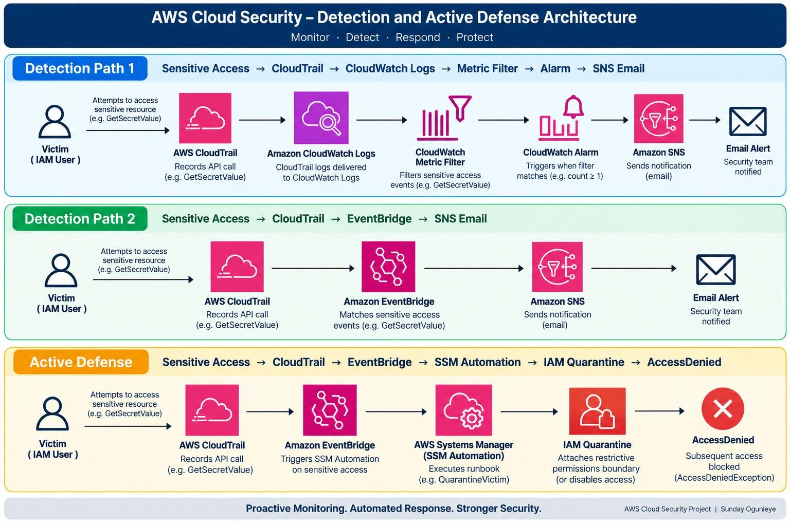
*Figure A — Detection paths and the active-defense path.*

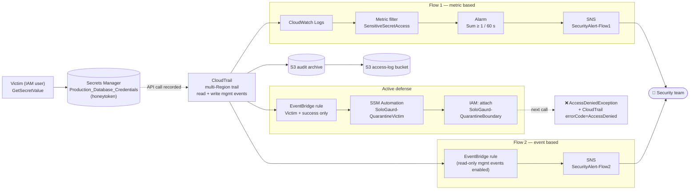

<details>
<summary>Planning-stage design sketch</summary>

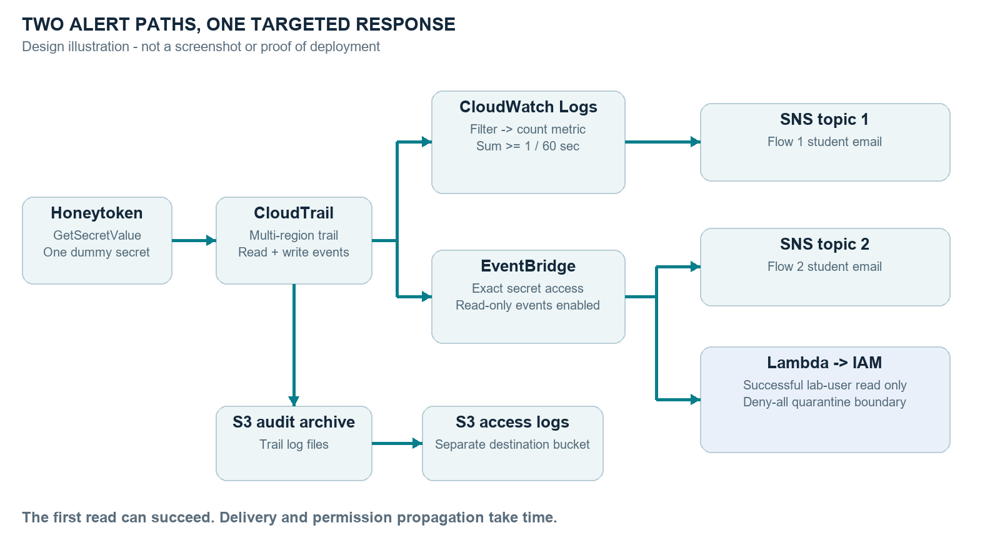

*Early design illustration (not a deployment screenshot). It shows Lambda as the responder; the implemented and tested lab uses SSM Automation instead — see §8.3.*
</details>

> **Timing caveat.** The first read is *allowed to succeed* — that is what produces the detection event. CloudTrail delivery, rule evaluation, the automation run and IAM propagation all take time, so containment applies to the **next** attempt, not the first.

---

## 4. Component reference

| Layer | Resource (as deployed) | Role in the lab | Config in this repo |
|---|---|---|---|
| Audit | CloudTrail trail, multi-Region, management events **Read + Write**, log-file validation | Records every Secrets Manager API call | [`config/cloudtrail/trail.json`](config/cloudtrail/trail.json) |
| Archive | S3 trail bucket + separate S3 server-access-log bucket | Durable, tamper-evident log storage | [`scripts/deploy.sh`](scripts/deploy.sh) §2 |
| Logs | CloudWatch Logs group receiving the trail | Searchable stream for the metric filter | [`scripts/deploy.sh`](scripts/deploy.sh) §3 |
| Flow 1 | Metric filter → metric `SoloGaurd/Security · SensitiveSecretAccess` | Counts honeytoken reads | [`config/cloudwatch/metric-filter.json`](config/cloudwatch/metric-filter.json) |
| Flow 1 | Alarm `SoloGaurd-SensitiveSecretAccess-Alarm` — Sum ≥ 1, 1 × 60 s, missing data = not breaching | Fires on the first read | [`config/cloudwatch/alarm.json`](config/cloudwatch/alarm.json) |
| Notify | SNS `SoloGaurd-SecurityAlert-Flow1` (email) | Flow 1 alert | — |
| Flow 2 | EventBridge rule `SoloGaurd-SensitiveSecretAccess-EventBridge`, state *Enabled with CloudTrail read-only management events* | Matches the API call directly | [`config/eventbridge/flow2-alert-pattern.json`](config/eventbridge/flow2-alert-pattern.json) |
| Notify | SNS `SoloGaurd-SecurityAlert-Flow2` (email), topic policy for `events.amazonaws.com` | Flow 2 alert with full event context | [`config/iam/sns-topic-policy-flow2.json`](config/iam/sns-topic-policy-flow2.json) |
| Respond | EventBridge rule `SoloGaurd-SensitiveAccess-Quarantine` | Triggers containment for successful Victim reads | [`config/eventbridge/active-defense-pattern.json`](config/eventbridge/active-defense-pattern.json) |
| Respond | EventBridge rule `SoloGaurd-SensitiveAccess-KillSwitch` (earlier variant) | Triggers key deactivation | same pattern + [`killswitch-target-input-transformer.json`](config/eventbridge/killswitch-target-input-transformer.json) |
| Respond | SSM Automation `SoloGaurd-QuarantineVictim` / `SoloGaurd-DisableVictimAccessKey` | Executes the IAM change and verifies it | [`config/ssm/`](config/ssm) |
| Contain | IAM managed policy `SoloGaurd-QuarantineBoundary` (`Deny * on *`) | Caps the user's effective permissions at zero | [`config/iam/quarantine-boundary-policy.json`](config/iam/quarantine-boundary-policy.json) |
| Least privilege | `SoloGaurd-SSMAutomationRole`, `SoloGaurd-EventBridgeInvokeSSMRole` | Scoped to the Victim user, this boundary and these two runbooks | [`config/iam/`](config/iam) |
| Secret | `Production_Database_Credentials` (encrypted with `aws/secretsmanager`) | Honeytoken | [`scripts/deploy.sh`](scripts/deploy.sh) §1 |

> Resource names keep the original **"SoloGaurd"** spelling used in AWS so they match the screenshots. Configuration files are reconstructions of what was deployed, with the account ID replaced by `<ACCOUNT_ID>`.

---

## 5. How each path works

### 5.1 Flow 1 — CloudWatch metric filter + alarm

1. CloudTrail writes each event to the CloudWatch Logs group (usually within a few minutes — CloudTrail-to-Logs delivery is batched).
2. The metric filter matches:
   ```text
   { ($.eventSource = "secretsmanager.amazonaws.com") &&
     ($.eventName  = "GetSecretValue") &&
     ($.requestParameters.secretId = "*Production_Database_Credentials*") }
   ```
   and emits `1` to `SoloGaurd/Security · SensitiveSecretAccess`.
3. The alarm evaluates `Sum` over a 60-second period; one datapoint ≥ 1 moves it from `OK` to `ALARM`.
4. The alarm action publishes to `SoloGaurd-SecurityAlert-Flow1`, which emails the subscriber.

**Strength:** simple, threshold-based, gives a metric you can graph and trend. **Weakness:** the email describes the *alarm state*, not *who did what* — the analyst still has to go to CloudTrail.

### 5.2 Flow 2 — EventBridge direct match

1. CloudTrail delivers the management event to the default event bus as `detail-type: "AWS API Call via CloudTrail"`.
2. **`GetSecretValue` is a read-only management event.** EventBridge rules do not receive read-only events unless the rule state is set to **`ENABLED_WITH_ALL_CLOUDTRAIL_MANAGEMENT_EVENTS`** ("Enabled with CloudTrail read-only management events" in the console — visible in Figure 2). This is the single most common reason a rule like this silently never fires.
3. The rule matches `eventSource`, `eventName` and the honeytoken `secretId`, and publishes the **entire event** to `SoloGaurd-SecurityAlert-Flow2`.

**Strength:** fewer hops, and the alert contains the IAM identity, access key ID, source IP, Region, API action and target secret.

### 5.3 Active defense — EventBridge → SSM Automation → IAM

1. A second rule uses a narrower pattern: same API and secret, **plus** `userIdentity.userName = "Victim"` and **`errorCode` does not exist** (successful reads only). The success filter matters: without it, the denied retry would trigger the runbook again.
2. An input transformer extracts the user name and passes `{"UserName": ["Victim"]}` to the runbook (SSM parameters must be lists of strings).
3. The EventBridge target role may only call `ssm:StartAutomationExecution` on the two SoloGaurd runbooks and pass the automation role to SSM.
4. The runbook `SoloGaurd-QuarantineVictim` calls `iam:PutUserPermissionsBoundary` with `SoloGaurd-QuarantineBoundary`, then asserts that `GetUser` returns that boundary ARN. Its role can only attach *that* boundary to *that* user (enforced with the `iam:PermissionsBoundary` condition key).
5. From the next request on, IAM evaluates: identity policy *Allow* ∩ boundary *Deny \** → **explicit deny wins**, and the request fails with `AccessDeniedException`.

**Why an explicit deny rather than an empty boundary?** An *explicit* `Deny` in a boundary overrides everything, including same-account resource-based policies that name the user directly — an implicit deny (an empty or narrow `Allow` boundary) does not block those. A deny-all boundary is therefore the safer quarantine.

### 5.4 Kill-switch variant (first implementation)

The `SoloGaurd-SensitiveAccess-KillSwitch` rule used the same pattern but passed `UserName` and `userIdentity.accessKeyId` to `SoloGaurd-DisableVictimAccessKey`, which set the key to `Inactive`. It worked, but the follow-up call failed at **authentication** (the key is no longer recognised) rather than **authorization**, so there was no `AccessDenied` record tying the denied attempt to the quarantined user. I kept both response rules in the account, enabling only one at a time, and ran the quarantine variant separately (with the key left active) to produce the required evidence.

| | Kill-switch (disable key) | Quarantine (deny-all boundary) |
|---|---|---|
| Layer of failure | Authentication | Authorization |
| Client error | `InvalidClientTokenId` / `UnrecognizedClientException` | `AccessDeniedException` — *explicit deny in a permissions boundary* |
| CloudTrail record | Request may not be attributable to the user in the same way | `errorCode: AccessDenied` with full `userIdentity` |
| User & key preserved | Key disabled | ✅ both intact for forensics |
| Reversal | Re-activate key | `DeleteUserPermissionsBoundary` |
| Covers console / other keys | ❌ only that key | ✅ all programmatic and console actions of the user |

---

## 6. Evidence

All screenshots are from the live lab. Account IDs, access key IDs and the source IP are redacted.

### 6.1 Configuration

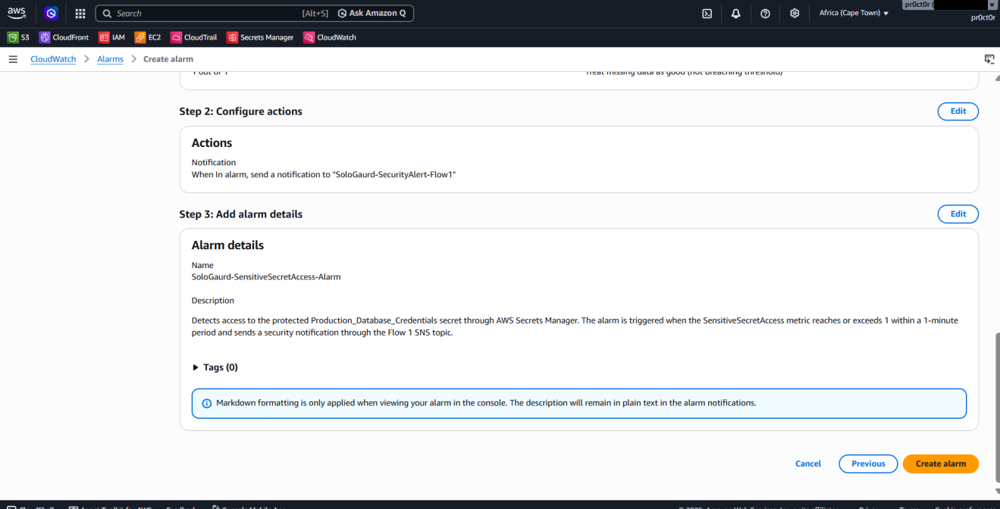
*Figure 1 — `SoloGaurd-SensitiveSecretAccess-Alarm`: action publishes to `SoloGaurd-SecurityAlert-Flow1`; triggers when `SensitiveSecretAccess` ≥ 1 within one minute.*

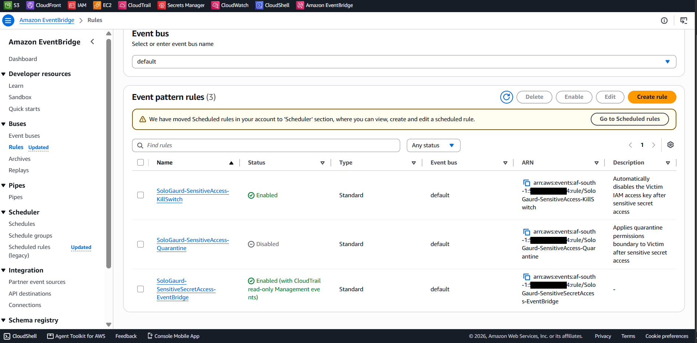
*Figure 2 — The three EventBridge rules on the default bus: the Flow 2 alert rule (enabled **with CloudTrail read-only management events**), the KillSwitch rule (enabled at the time of capture) and the Quarantine rule (disabled at the time of capture — the two response rules were run one at a time).*

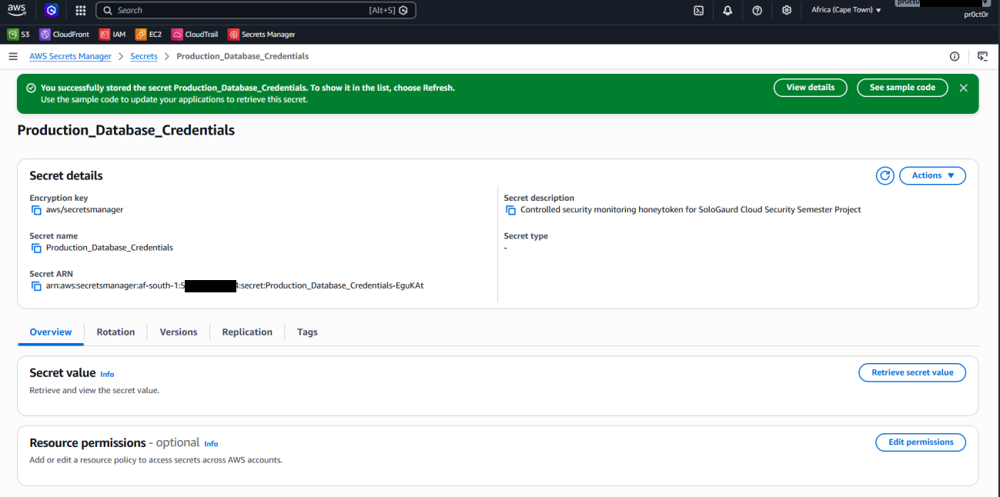
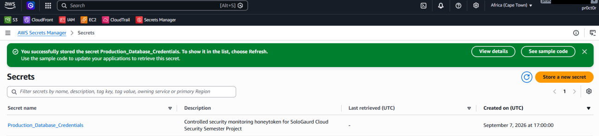
*Figure 3 — Honeytoken `Production_Database_Credentials` created 7 Sep 2026 17:00:00 UTC, encrypted with `aws/secretsmanager`, described as a controlled monitoring honeytoken.*

### 6.2 Audit trail

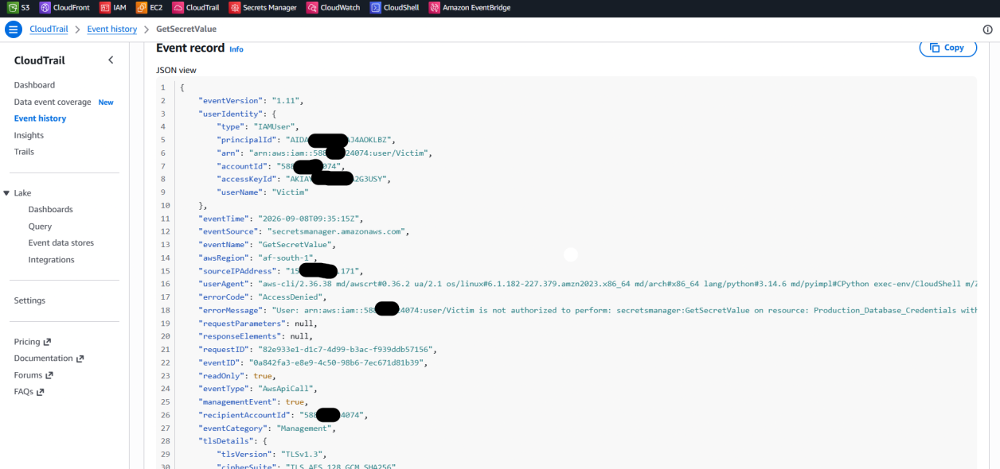
*Figure 4 — CloudTrail event record for the denied `GetSecretValue`: `userIdentity.type = IAMUser`, `userName = Victim`, `eventTime = 2026-09-08T09:35:15Z`, `awsRegion = af-south-1`, `errorCode = AccessDenied`, `readOnly = true`, `managementEvent = true`, user agent `aws-cli/2.36.38 … exec-env/CloudShell`, TLS 1.3.*

### 6.3 Detection

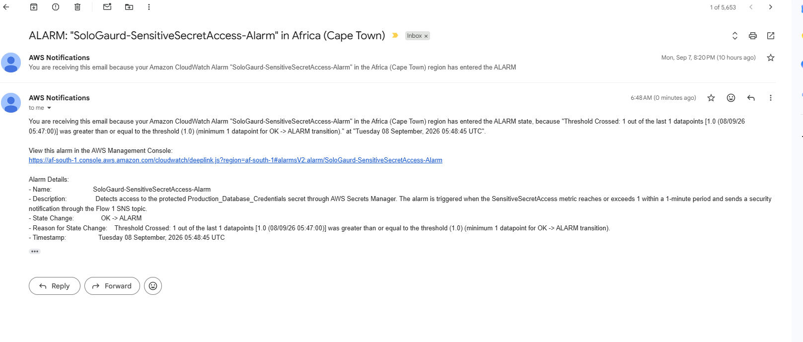
*Figure 5 — Flow 1 SNS email: alarm moved `OK → ALARM` because 1 datapoint (1.0 at 08/09/26 05:47:00) met the threshold; timestamp 08 Sep 2026 05:48:45 UTC. An earlier alarm from the first test run on 7 Sep is visible above it.*

Flow 2 was configured through EventBridge and SNS and its email was received during the lab. Because it forwards the raw CloudTrail event, it carried the IAM identity, source address, secret and API action.

### 6.4 Containment

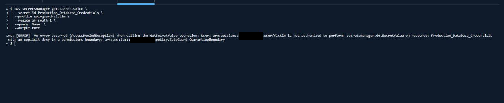
*Figure 6 — The Victim's retry from CloudShell fails: `AccessDeniedException … User: arn:aws:iam::<account>:user/Victim is not authorized to perform: secretsmanager:GetSecretValue on resource: Production_Database_Credentials with an explicit deny in a permissions boundary: arn:aws:iam::<account>:policy/SoloGaurd-QuarantineBoundary`.*

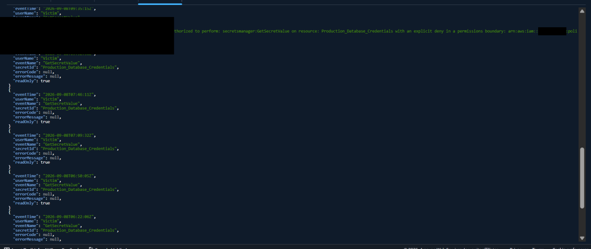
*Figure 7 — Extraction of the Victim's `GetSecretValue` events: the most recent (09:35:15Z) carries the boundary-deny message; earlier calls (06:22:06Z, 06:50:05Z, 07:09:32Z, 07:46:11Z, …) have `errorCode: null` — successful reads during the test runs.*

### 6.5 Forensic record of the denied attempt

| Field | Observed value |
|---|---|
| `eventTime` | `2026-09-08T09:35:15Z` (denied second attempt) |
| `userIdentity.type` | `IAMUser` |
| `userIdentity.userName` | `Victim` |
| `sourceIPAddress` | *redacted* (original retained) |
| `userAgent` | `aws-cli/2.36.38 … exec-env/CloudShell` |
| `eventSource` | `secretsmanager.amazonaws.com` |
| `eventName` | `GetSecretValue` |
| `awsRegion` | `af-south-1` |
| `errorCode` | `AccessDenied` |
| `errorMessage` | … explicit deny in a permissions boundary: `SoloGaurd-QuarantineBoundary` |
| `requestParameters` / `responseElements` | `null` (request rejected before the secret was resolved) |
| `readOnly` / `managementEvent` | `true` / `true` |
| `eventCategory` | `Management` |

---

## 7. Forensic correlation & timeline

The evidence forms one time-ordered chain. Each stage is backed by a separate, independent source, so the conclusion does not rest on any single screenshot.

| # | Stage | Evidence | Result |
|---|---|---|---|
| 1 | Initial state | Victim key `Active`, no boundary | Victim can read the secret |
| 2 | Access | CloudTrail `GetSecretValue`, `errorCode: null` | Sensitive access recorded |
| 3 | Detection | Flow 1 alarm email (Fig. 5), Flow 2 email | Security team notified |
| 4 | Response | EventBridge → `SoloGaurd-QuarantineVictim` execution | Automation `Success` |
| 5 | Containment | `SoloGaurd-QuarantineBoundary` attached to Victim | Explicit deny in effect |
| 6 | Retry | CLI `GetSecretValue` (Fig. 6) | `AccessDeniedException` |
| 7 | Verification | CloudTrail `errorCode: AccessDenied` (Fig. 4, 7) | Server-side confirmation |

Key timestamps (UTC): secret created **7 Sep 17:00:00** → Flow 1 datapoint **8 Sep 05:47:00**, alarm **05:48:45** → successful Victim reads **06:22:06, 06:50:05, 07:09:32, 07:46:11** → denied retry **09:35:15**. The full timeline and how to rebuild it is in [`docs/forensic-timeline.md`](docs/forensic-timeline.md).

> **Forensic distinction.** Disabling an access key causes an *authentication*-layer failure. A deny-all permissions boundary keeps the key valid, so the request is authenticated, reaches *authorization*, and is denied with a fully attributed `AccessDenied` CloudTrail record. For an investigation, the second outcome is far more useful.

---

## 8. Security analysis (assignment questions)

### 8.1 Speed — Flow 1 vs Flow 2

**Flow 2 (EventBridge) is the faster path.** Flow 1 has five hops — CloudTrail → CloudWatch Logs delivery (batched) → metric-filter evaluation → a 60-second alarm period → SNS. Flow 2 evaluates the CloudTrail event as it arrives on the event bus and goes straight to SNS. The 60-second period alone means Flow 1 can never be faster than the minute bucket closing. *(I did not instrument exact end-to-end latencies; a measured comparison is listed as future work.)*

### 8.2 Context — which alert is more useful?

**Flow 2.** Its email is the CloudTrail event itself: identity (`Victim`), access key ID, source IP, Region, API action and the targeted secret — enough to begin triage immediately. Flow 1's email says *that* a threshold was crossed (count, period, timestamp) but not *who* or *from where*; the analyst must pivot to CloudTrail. Flow 1 remains valuable for dashboards and volume-based detection (e.g. "more than N secret reads in 5 minutes across all secrets").

### 8.3 Which service for automatic blocking?

I used **EventBridge as the trigger and Systems Manager Automation as the executor**. SSM Automation suits this well: the runbook is declarative YAML, every execution is logged with inputs, outputs and step status, it can verify its own result (`aws:assertAwsResourceProperty`), and it runs under a dedicated least-privilege role. **AWS Lambda** is the better choice when the response needs branching logic or enrichment — e.g. checking an allow-list, looking up the principal's owner, opening a ticket, or choosing between quarantine and key revocation. A design diagram from the planning stage showed Lambda; the implemented and tested lab uses SSM.

### 8.4 Continuous monitoring & NIST

The lab demonstrates the continuous-monitoring cycle described in **NIST SP 800-137** — define what to monitor, collect, analyse, respond, and review — and maps onto the **NIST Cybersecurity Framework 2.0** functions:

| CSF 2.0 function | Lab implementation |
|---|---|
| **Identify** | Honeytoken designated as a high-value decoy asset |
| **Protect** | Least-privilege Victim policy; scoped automation roles; S3 public-access block |
| **Detect** (DE.CM — continuous monitoring) | CloudTrail collection; metric filter + alarm; EventBridge pattern |
| **Respond** (RS.MI — incident mitigation) | Automated quarantine through SSM + IAM boundary |
| **Recover** | Documented reversal (`scripts/reset-victim.sh`) |
| **Govern** | Not addressed beyond this report — see §10 |

This is a practical demonstration of continuous-monitoring principles; it is **not** a claim of NIST compliance.

### 8.5 Metric filter or EventBridge for the kill-switch?

**EventBridge.** A kill-switch must react to *one specific event* and act on *the principal in that event*. EventBridge matches on identity, API, resource and outcome fields, and can hand those fields to the response target through an input transformer. A metric filter collapses events into a number — the alarm knows "≥ 1 happened" but not *which user* to contain, so it cannot target a response precisely. Metric filters are the right tool for dashboards, thresholds and trends.

---

## 9. Lessons learned

1. **Detection and response are different problems.** A design is only as strong as the controlled link between them.
2. **EventBridge is well suited to event-driven security automation** — direct CloudTrail matching plus a native SSM Automation target.
3. **Read-only events need opting in.** `GetSecretValue` is read-only; the rule had to be set to receive read-only management events before it would fire.
4. **Authentication failure ≠ authorization failure.** Disabling a key and attaching a deny boundary produce very different forensic records.
5. **Permissions boundaries make good emergency containment** — the user, key and history stay intact while effective permissions drop to zero, and the change is one API call to reverse.
6. **Least privilege applies to the responders too.** Automation roles were scoped to the one user, one boundary and two runbooks rather than administrator access.
7. **Filter for success in response rules.** Matching only events with no `errorCode` stops the denied retry from re-triggering automation.
8. **Correlate, don't assume.** The conclusion rests on four independent sources: automation status, IAM boundary state, the CLI error and CloudTrail.
9. **Testing reveals what configuration screens hide.** I validated the EventBridge pattern against a real CloudTrail event and fixed the Automation target input before the quarantine run succeeded.

---

## 10. Limitations & production hardening

This is a learning-scale lab in a single account and Region. For a production (e.g. banking) environment I would extend it as follows — details in [`docs/production-hardening.md`](docs/production-hardening.md):

- **Existing sessions.** A boundary or key deactivation does not end STS sessions already issued to roles; for roles, add an inline deny on `aws:TokenIssueTime` (the "revoke active sessions" pattern).
- **Coverage.** Use an AWS Organizations trail and a delegated security account; add GuardDuty, Security Hub and IAM Access Analyzer; cover every secret, not one honeytoken.
- **Integrity.** Send CloudTrail to a separate log-archive account with S3 Object Lock and KMS encryption.
- **Response safety.** Allow-lists and break-glass exclusions, an approval step for high-impact actions, idempotent runbooks, and alerting on automation failure (dead-letter queue on the EventBridge target).
- **Operations.** Route alerts to a SIEM / ticketing system instead of email; define severity, on-call and runbook ownership.

---

## 11. Reproduce the lab

> ⚠️ Use a **sandbox account**. The scripts create IAM users, roles and a trail, and `teardown.sh` deletes them. `af-south-1` is an opt-in Region and must be enabled first.

```bash
git clone https://github.com/proct0r/aws-security-monitoring-active-defense.git
cd aws-security-monitoring-active-defense

ALERT_EMAIL=you@example.com ./scripts/deploy.sh   # build everything
# confirm both SNS subscription emails, then create the Victim key:
aws iam create-access-key --user-name Victim
aws configure --profile sologuard-victim

./scripts/simulate-access.sh      # read → wait → read again (expect AccessDenied)
./scripts/collect-evidence.sh     # CloudTrail, IAM, SSM and alarm evidence → ./evidence/
./scripts/reset-victim.sh         # remove boundary / re-activate key to re-run
./scripts/teardown.sh             # delete all lab resources
```

The console-based walk-through, with the reason for every setting, is in [`docs/build-guide.md`](docs/build-guide.md). If something does not fire, see [`docs/troubleshooting.md`](docs/troubleshooting.md).

---

## 12. Repository layout

```text
.
├── README.md                     ← this report
├── config/
│   ├── cloudtrail/trail.json
│   ├── cloudwatch/               ← metric filter + alarm
│   ├── eventbridge/              ← Flow 2 + active-defense patterns, input transformers
│   ├── iam/                      ← quarantine boundary, Victim policy, least-privilege roles, SNS policy
│   └── ssm/                      ← QuarantineVictim + DisableVictimAccessKey runbooks
├── scripts/                      ← deploy, simulate, collect evidence, reset, teardown
├── docs/
│   ├── build-guide.md
│   ├── forensic-timeline.md
│   ├── troubleshooting.md
│   ├── production-hardening.md
│   └── review-notes.md
└── images/                       ← redacted evidence screenshots and diagrams
```

---

## 13. Submission evidence checklist

| Requirement | Where |
|---|---|
| Executive summary | [§1](#1-executive-summary) |
| CloudWatch alarm screenshot | Figure 1 |
| EventBridge rule screenshot | Figure 2 |
| Honeytoken secret | Figure 3 |
| CloudTrail eventTime / identity / source IP | Figure 4, [§6.5](#65-forensic-record-of-the-denied-attempt) |
| Detection email (Flow 1) | Figure 5 |
| Victim quarantine boundary in effect | Figure 6 (boundary ARN in the error), [§7](#7-forensic-correlation--timeline) |
| CLI `AccessDenied` | Figure 6 |
| CloudTrail `errorCode: AccessDenied` | Figures 4 and 7 |
| Security analysis | [§8](#8-security-analysis-assignment-questions) |
| Lessons learned | [§9](#9-lessons-learned) |

---

*Sunday Ogunleye · Cloud Security Semester Project · 2026*
